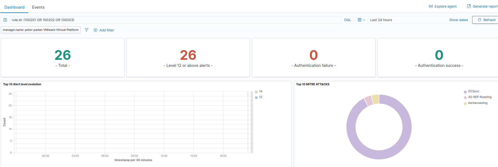

# Active Directory Identity Attack, SIEM Detection & Hardening Lab

An end-to-end Detection Engineering and Active Directory security lab simulating real-world MITRE ATT&CK identity attacks (**AS-REP Roasting**, **Kerberoasting**, and **DCSync**), engineering low-noise **Wazuh SIEM (`v4.14.2`)** custom XML rules, and automating domain auditing and remediation via **PowerShell**.

---

## Lab Architecture (`192.168.4.0/24` — VMware Bridged)

| Hostname | IP Address | OS / Platform | Role | Key Telemetry & Ports |
| :--- | :--- | :--- | :--- | :--- |
| **DC01** | `192.168.4.20` | Windows Server 2012 R2 | Primary Domain Controller (`brazos.local`) | AD DS, DNS, Kerberos (`88`), RPC (`135`), SMB (`445`) |
| **Wazuh Manager** | `192.168.4.24` | Ubuntu Linux | SIEM & Detection Engine (`v4.14.2`) | Dashboard (`443`), Agent Logs (`1514`), Enrollment (`1515`) |
| **Kali Linux** | `192.168.4.50` | Kali Linux (`2026.2`) | Offensive Audit & Red Team Host | Impacket (`v0.12.0`), Nmap |

---

## MITRE ATT&CK Coverage & Custom Wazuh Rules (`rules/local_rules.xml`)

| Rule ID | Severity | MITRE ATT&CK Technique | Windows Event ID | Detection Logic & False-Positive Tuning |
| :--- | :--- | :--- | :--- | :--- |
| **`100201`** | Level 12 | **T1558.003** — Kerberoasting | `4769` (TGS Request) | Flags `0x17` (RC4-HMAC) service ticket requests while excluding `krbtgt` and machine (`$`) accounts. |
| **`100202`** | Level 12 | **T1558.004** — AS-REP Roasting | `4768` (TGT Request) | Detects `preAuthType = 0` combined with `0x17` (RC4) encryption on accounts lacking Kerberos pre-authentication. |
| **`100203`** | Level 14 | **T1003.006** — DCSync | `4662` (DS Access) | Alerts on Directory Replication GUIDs (`1131f6aa...` / `1131f6ad...`) initiated by non-machine (`$`) accounts. |

### Detection Engineering Note: Child-Rule Inheritance Fix
During validation on Wazuh `v4.14.2`, raw Windows Security Event IDs (`4768`, `4769`, `4662`) arrived at the manager without triggering custom rules initially because built-in Wazuh child rules matched the events before `<if_sid>60103</if_sid>` was evaluated. Refactoring parent matching to `<if_group>windows</if_group>` resolved rule-hierarchy precedence and immediately generated **26 Level 12+ alerts** across all three attack vectors.



---

## Offensive Attack Execution (Kali Linux + Impacket)

### 1. AS-REP Roasting (`T1558.004` → Rule `100202`)
Targeted domain user `legacy_app` (`UF_DONT_REQUIRE_PREAUTH` enabled) to extract an offline-crackable `$krb5asrep$23$` TGT hash without valid credentials:
```bash
impacket-GetNPUsers brazos.local/legacy_app -no-pass -dc-ip 192.168.4.20 -format hashcat
